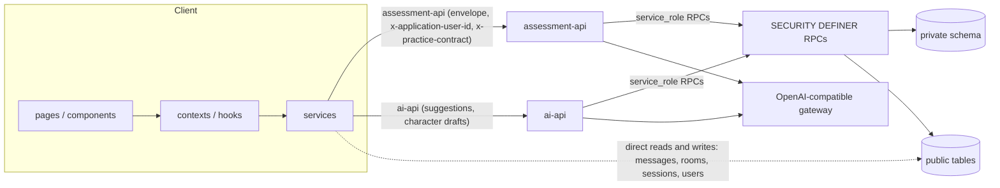
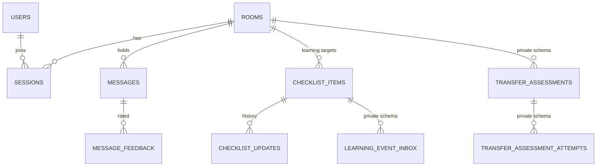
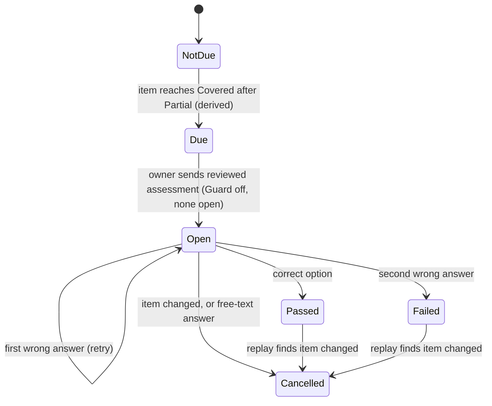
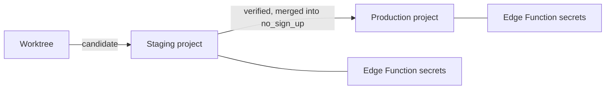

# Architecture Seed — Tutor platform

Intent: record the structure of the code as it is today, so a reader can find the module behind each role the spine names. The code owns this file: when the code changes, refresh it; no decision in the spine changes with it. Nothing here is a rule.

## Roles in the spine and their names today

| Role named in the spine | Name today |
| --- | --- |
| Learning-event writer | `apply_learning_event_v1` |
| Manual progress-edit writer | `edit_room_checklist_v1` |
| Reviewed-send function | `send_reviewed_tutor_response_v4` |
| Assessment answer-post function | `post_assessment_message_v2` |
| Assessment grading function | `process_assessment_message_v2` |
| Assessment cancellation | `cancel_transfer_assessment_v1`, `publish_assessment_cancellation`, trigger `cancel_changed_target_assessments` |
| Trusted assessment gateway | Edge Function `assessment-api` |
| AI suggestion gateway | Edge Function `ai-api` |
| Room owner record | `rooms.tutor_id` |
| Learner seat | the room's learner session row |
| Room Guard flag | `rooms.guard_mode`; replay trigger `transfer_replay_guard` |
| Practice type | `rooms.practice_type` |
| Assessment source state | `private.transfer_assessments.lifecycle`; public projection `messages.assessment_lifecycle` |
| In-room switch, operator switch | `rooms.transfer_learning_enabled`, `TRANSFER_ASSESSMENT_ENABLED` |
| AI provider secrets | `OAI_API_KEY`, `OAI_BASE_URL` |
| Version handshake | header `x-practice-contract` (value `cyberbullying-v2`), SQL check `private.assert_practice_contract` |
| Identity header | `x-application-user-id` |
| Terminal event key | `assessment:<id>` |
| Held states | answers `guard_deferred`, events `deferred_guard` |
| Dedupe keys | `assessment_request_id`, event `dedupe_key` |
| Append-only history | `checklist_updates`, `coverage_evidence` |
| Shared rule modules (in `src/`) | `learningProgressTransitions`, assessment validation, `aiModels` |

## Stack

| Name | Version |
| --- | --- |
| React, React DOM | ^18.2.0 (lockfile-resolved) |
| TypeScript | ^4.9.5 |
| react-scripts (Create React App) | 5.0.1 |
| react-router-dom | ^6.20.1 |
| @supabase/supabase-js, browser | ^2.39.0 (lock resolves 2.51.0) |
| @supabase/supabase-js, `assessment-api` | 2.39.0 pinned through esm.sh |
| Supabase: Postgres, Realtime, Edge Functions (Deno) | production `zgbufaxooqxeabewktzd`, staging `ciubrzggdqesgvfkpolj` |
| Jest (bundled with react-scripts), React Testing Library, jest-cucumber | bundled with CRA 5, ^13.4.0, ^4.5.0 |
| AI provider | one OpenAI-compatible gateway; model identifiers in shared config |

Support notes: Create React App has been deprecated since February 2025, and Supabase now prefers `npm:` imports over esm.sh imports; the current choices still work. TypeScript 4.9 support status, the hosted Deno version and the bundled Jest version are unconfirmed.

## Where things live

```text
tutor-system/
  src/            # client: pages, components, contexts, hooks, services, utils, types
  supabase/
    functions/    # ai-api, assessment-api (Deno)
    archived_migrations/   # applied SQL; one pending migration at a time
evals/            # AI behavior evaluations
```

| Area | Lives in |
| --- | --- |
| Identity, join, roles | `AuthContext`, `join_room_v1` |
| Rooms and templates | `rooms`, `room_templates` (cyberbullying templates are seeded global rows), `RoomContext`, `useRoomMembership` |
| Conversation and rating | `messages`, `message_feedback`, `useRoomRealtime` (channel, recovery, typing), `roomMessageSync`, `useMessageFeedback`; `RoomContext` keeps AI and assessment coordination |
| Learning progress | `checklist_items`, the learning-event and manual-edit writers |
| Guard | the room Guard flag, replay trigger |
| Supervision and AI drafts | `ai-api`, `aiService`, the reviewed-send function |
| Transfer assessment | `assessment-api`, `private.transfer_assessments` |
| Cyberbullying rooms | `ai-api` operation `cyberbullying_suggest`, its context function |
| Exports | export service, `ai_suggestion_feedback` |

## Diagrams









## Configuration and release

Client variables are `REACT_APP_*`. Edge Function secrets are set per project and never committed. The checked-in `tutor-system/.env` targets production, so tests name their target explicitly. Release order and gates are in `AGENTS.md` and `tutor-system/docs/supabase-release-workflow.md`.

## Open facts

- Client hosting and its deploy pipeline are not in the repository evidence.
- Whether the client's catch-up always runs for held answers is not confirmed.
