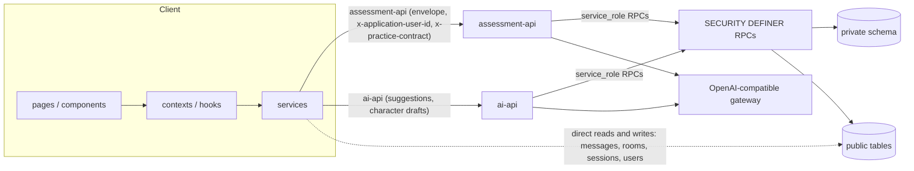
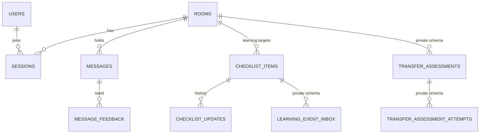
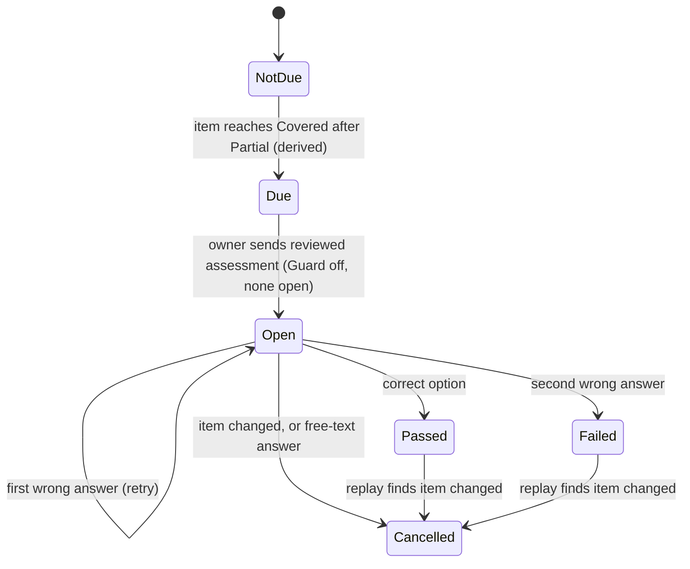
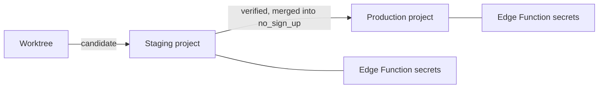

# Architecture Spine — Tutor platform

Intent: fix the cross-cutting decisions that keep independently built features compatible, so a new feature can be checked against how shared state is owned and changed. Code owns everything else.

Tags: **[ADOPTED]** the code already follows the rule. **[TARGET]** the rule is what new work must follow; the code does not fully meet it yet, and the differences are tracked in the PRD addendum, not here. **[ASSUMPTION]** the code's behavior, not yet an owner decision.

## Design Paradigm

**Server-authoritative state behind a trusted gateway.** Anything that decides learning progress or an assessment outcome runs on the server, in Postgres functions reached through an Edge Function. The browser asks, renders and keeps drafts and caches only.

| Layer | Where | Role |
| --- | --- | --- |
| Client | `tutor-system/src/` (`pages`, `components`, `contexts`, `hooks`, `services`, `utils`, `types`) | Render, collect input, call services |
| Gateway | `tutor-system/supabase/functions/assessment-api`, `ai-api` | Identify the caller, call the AI provider, call RPCs |
| State | Postgres: `public` tables (open to every client), `private` schema (closed) and SECURITY DEFINER RPCs | Writers of progress and assessment state |



Dependency direction: pages → components → contexts and hooks → services → Supabase and Edge Functions. Services and utils do not import a context or a component. Edge Functions may import shared rule modules from `src/` and nothing else from the client.

## Invariants & Rules

### AD-1 — One writer per progress and assessment entity [TARGET]

- **Binds:** FR-19..FR-23, FR-38..FR-41, FR-53, C2, C3
- **Prevents:** two code paths changing the same progress or assessment row, so the learning record disagrees with itself.
- **Rule:** item progress changes only through `apply_learning_event_v1` (model and assessment events) or `edit_room_checklist_v1` (the owner's manual edit); assessment state changes only through `send_reviewed_tutor_response_v4` (create), `process_assessment_message_v2` (grade and close) and the cancel functions. No new writer is added: not in the client, not in another RPC, not in an Edge Function. History tables (`checklist_updates`, `coverage_evidence`) are append-only.

### AD-2 — Judging and grading go through assessment-api; the server picks the path [TARGET]

- **Binds:** FR-18, FR-20, FR-31, FR-37, FR-46, NFR-2, C3
- **Prevents:** a feature judging a learner message, or changing progress, from the browser; the path depending on a switch the owner can flip.
- **Rule:** every operation that judges a learner message, grades an answer or changes progress is an `assessment-api` operation. Every new room is created on the trusted path (`progress_policy_version` `transfer_v1`), and the path is chosen from the room's policy version and practice type, not from the in-room assessment switch. The browser-side judging path serves rooms that already exist and receives no new code. A learner message in a trusted-path room is accepted only when written by `post_assessment_message_v2`.

### AD-3 — Assessment due is derived, never stored [ADOPTED] (owner decision 2026-10-22)

- **Binds:** FR-32, FR-35
- **Prevents:** a stored "due" or "rejected" flag drifting from the progress history.
- **Rule:** due is computed from the item's progress history. Rejecting or discarding an assessment draft is client-local and writes no assessment state; the assessment is offered again at the next request unless one is open, terminal feedback is pending, or Guard is on. The reject warning (FR-35) is a client message, not new state.

### AD-4 — Grading is one transaction; one terminal event per assessment [ADOPTED]

- **Binds:** FR-38, FR-39, FR-40, NFR-2, NFR-5
- **Prevents:** a grade without its progress change or result message, or two terminal events for one assessment.
- **Rule:** `process_assessment_message_v2` commits the grade, the progress event, the attempt row and the result message in one transaction. The terminal event key is `assessment:<id>`. The learner's answer message is saved in an earlier transaction.

### AD-5 — Guard defers progress, not storage; one writer for the Guard flag [TARGET]

- **Binds:** FR-22, FR-30, C2
- **Prevents:** progress advancing while the owner has paused it, events silently lost, and Guard switched by something other than the owner.
- **Rule:** while Guard is on, an assessment answer is not graded, consumes no attempt and gets no result message (`guard_deferred`); direct progress writes are blocked by triggers; learning events are stored as `deferred_guard`. When Guard turns off, deferred events replay in creation order and are re-validated against the current item; an event whose target wording changed or whose item was deleted is rejected, and an assessment whose item changed is cancelled. Un-graded answers are processed afterwards by client catch-up or the owner's review read. `rooms.guard_mode` is changed only by one owner-checked operation; sending a reply reads it and never changes it.

### AD-6 — A sent assessment ends only by its own rules [ADOPTED] (owner decision 2026-10-22)

- **Binds:** FR-31, FR-32, FR-35, FR-37, FR-53, FR-40
- **Prevents:** an open assessment grading against an item that has since changed; a sent question being withdrawn, which would confuse the learner (P5).
- **Rule:** the room owner edits or rejects an assessment draft before it is sent (FR-35); once sent, no owner operation closes it. A sent assessment ends by the learner's correct answer, by the second wrong answer, or by a free-text answer (cancelled as "assisted", no attempt used). A change to an item's status, understanding level, wording or deletion cancels its open assessment and writes one closure message (`publish_assessment_cancellation`); priority and notes edits do not. Turning in-room assessment off, or the operator flag `TRANSFER_ASSESSMENT_ENABLED` off, does not cancel. While Guard is on, or the operator flag is off, the learner's answer waits; both are reversible by the owner or the operator.

### AD-7 — Every state-changing request is repeatable [TARGET]

- **Binds:** NFR-5, FR-36, FR-38
- **Prevents:** a retry, reload or second tab creating a duplicate message, attempt or event.
- **Rule:** every mutating operation carries a request id that the caller keeps across retries of the same user action; messages and events are deduplicated by unique keys (`assessment_request_id`, event `dedupe_key`, one result message per answer, one closure message per question); attempt counts use compare-and-set and the Edge Function retries up to three times. A new mutating operation defines its dedupe key before it ships.

### AD-8 — Roles and ownership come from the room, and are checked in SQL [TARGET]

- **Binds:** FR-2, FR-9, FR-12, FR-30, FR-52, NFR-1, NFR-4, C1
- **Prevents:** a tutor-only action protected by a browser check; a user changing a profile role and thereby taking another role in the same room.
- **Rule:** identity is client-asserted (`x-application-user-id`), accepted for the pilot. Within a room, owner, learner and observer are derived from the room's own records (`rooms.tutor_id`, the learner session), never from `users.current_role`. The owner of a room never holds its learner seat and never answers an assessment. Every tutor-only operation, including Guard, AI configuration, learning-target setup, tutor replies and room deletion, is an RPC that checks `rooms.tutor_id = actor`. A tutor-only control is never a direct table write from the browser. The browser and Edge Function checks are convenience, never the control.

### AD-9 — Practice type is a fixed branch key [ADOPTED]

- **Binds:** FR-5, FR-7, FR-18, FR-44..FR-49
- **Prevents:** behavior chosen from room content, template name or a flag that can change after creation.
- **Rule:** `rooms.practice_type` (`phishing` or `cyberbullying`) is set at creation (FR-5). Practice-specific behavior branches on it and nowhere else; the PRD decides which controls exist for each type, and the code follows the PRD (for example manual progress edits are available in both types). Cyberbullying rooms always use the trusted path.

### AD-10 — Shared rules live once and change together [TARGET]

- **Binds:** FR-21, FR-34, NFR-10
- **Prevents:** the client, an Edge Function and SQL applying different progress transitions, validation or models.
- **Rule:** progress transitions, assessment validation and AI model identifiers live in `src/` once and are imported by the Edge Functions; no Edge Function hardcodes a model identifier. [ASSUMPTION: which model `assessment-api` uses is an owner decision still open; moving it from `qwen3.5-flash` to `qwen3.8-flash` needs an evaluation run first (NFR-10).] The SQL mirror of the transitions changes in the same release as the TypeScript. A change to an imported file means redeploying the functions that import it.

### AD-11 — One AI gateway and a version handshake [TARGET]

- **Binds:** FR-25, FR-33, FR-47, NFR-9, NFR-10, NFR-11, C6
- **Prevents:** a provider credential in the browser, a stale client talking to a changed server, a rollout that locks out working clients.
- **Rule:** every LLM call is made by `ai-api` or `assessment-api` with server-side secrets (`OAI_API_KEY`, `OAI_BASE_URL`). No `ai-api` operation that spends the provider key runs without an identified, authorized caller. Every POST carries `x-practice-contract`; a mismatch returns `CLIENT_RELOAD_REQUIRED`, and the same check runs in SQL (`private.assert_practice_contract`). A breaking change to a request or response shape bumps the contract version in this order: functions and SQL accept both versions, the new client ships, then the old version is dropped.

### AD-12 — Nothing secret in a public table; one source for assessment state [TARGET]

- **Binds:** FR-39, FR-42, FR-51, NFR-3, C5
- **Prevents:** an answer key, learner explanation or raw AI output readable by any client with the anon key; two copies of assessment state that disagree.
- **Rule:** `public` tables are open to every client. The answer key, learner explanation and raw AI output live in the `private` schema; the answer key and explanation reach `public.messages` only inside the result message written by the database function at the publication point. The assessment lifecycle in `private.transfer_assessments` is the source; any lifecycle value on a public message is a projection written in the same transaction and never read back as truth. Result and closure messages are inserted only by database functions.

### AD-13 — Learner-visible AI text has one path [TARGET]

- **Binds:** FR-28, FR-36, FR-48, NFR-1, C1
- **Prevents:** AI-generated text reaching a learner without the room owner's send.
- **Rule:** AI text becomes a learner-visible message only through the reviewed-send RPC, which checks `rooms.tutor_id = actor`. No other function or direct insert creates a tutor-authored or character message, and older send functions are not callable by anonymous clients.

### AD-14 — Room deletion is one owner-checked operation [TARGET]

- **Binds:** FR-9, FR-12, NFR-6, C4
- **Prevents:** orphaned private records after a room is deleted, or data removed by any other action.
- **Rule:** the only operation that removes room data is one owner-checked RPC that deletes the room and everything it holds in both the `public` and `private` schemas. No other action deletes messages, assessments or attempts; clearing chat history does not exist.

## Consistency Conventions

| Concern | Convention |
| --- | --- |
| Naming | Components and pages PascalCase; services, hooks and utils camelCase; tests `*.test.ts(x)` in `__tests__/`; database and API fields snake_case; a replaced RPC gets a new version suffix. |
| Edge Function envelope | `assessment-api`: request `{operation, request_id, ...}`, response `{ok: true, data}` or `{ok: false, error: {code, message, retryable}}`, types in `src/types/assessmentApi.ts`. `ai-api` returns `{error: {code}}` on failure; a new operation uses the `assessment-api` envelope. Error codes are upper snake case. |
| Identity and contract headers | `x-application-user-id` (UUID derived from name and role) and `x-practice-contract` on every call to an Edge Function that identifies a user. |
| State and mutation | Server tables are the source of truth. Messages arrive by realtime insert plus a 2-second poll and merge by message id. |
| Errors | Fail visibly (NFR-7). A thrown error carries a code; best-effort side effects log and never hide the failure. |
| Configuration and secrets | Client variables are `REACT_APP_*`. Edge Function secrets (`OAI_API_KEY`, `OAI_BASE_URL`, `TRANSFER_ASSESSMENT_ENABLED`) are set per project, never committed. The checked-in `tutor-system/.env` targets production, so tests name their target explicitly. |
| Release | Staging before production; SQL before a dependent Edge Function; one pending migration; merge into `no_sign_up` before any production change (see `AGENTS.md` and `tutor-system/docs/supabase-release-workflow.md`). |

## Stack

| Name | Version |
| --- | --- |
| React, React DOM | ^18.2.0 (lockfile-resolved) |
| TypeScript | ^4.9.5 |
| react-scripts (Create React App) | 5.0.1 |
| react-router-dom | ^6.20.1 |
| @supabase/supabase-js, browser | ^2.39.0 (lock resolves 2.51.0) |
| @supabase/supabase-js, `assessment-api` | 2.39.0 pinned through esm.sh |
| Supabase: Postgres, Realtime, Edge Functions (Deno) | production `zgbufaxooqxeabewktzd`, staging `ciubrzggdqesgvfkpolj` |
| Jest (bundled with react-scripts), React Testing Library, jest-cucumber | bundled with CRA 5, ^13.4.0, ^4.5.0 |
| AI provider | one OpenAI-compatible gateway; model identifiers in shared config |

## Structural Seed







```text
tutor-system/
  src/            # client: pages, components, contexts, hooks, services, utils, types
  supabase/
    functions/    # ai-api, assessment-api (Deno)
    archived_migrations/   # applied SQL; one pending migration at a time
evals/            # AI behavior evaluations
```

## Capability → Architecture Map

| Area | Lives in | Governed by |
| --- | --- | --- |
| Identity, join, roles (FR-1..FR-3) | `AuthContext`, `join_room_v1` | AD-8 |
| Rooms and templates (FR-4..FR-10) | `rooms`, `RoomContext` | AD-8, AD-9, AD-14 |
| Conversation and rating (FR-11..FR-16) | `messages`, `message_feedback`, `RoomContext` | AD-7, AD-12 |
| Learning progress (FR-19..FR-23, FR-53) | `checklist_items`, `apply_learning_event_v1`, `edit_room_checklist_v1` | AD-1, AD-2, AD-5, AD-10 |
| Guard (FR-22, FR-30) | `rooms.guard_mode`, replay trigger | AD-5, AD-8 |
| Supervision and AI drafts (FR-24..FR-30, FR-47, FR-48) | `ai-api`, `aiService`, reviewed-send RPC | AD-8, AD-11, AD-13 |
| Transfer assessment (FR-31..FR-43) | `assessment-api`, `private.transfer_assessments` | AD-1, AD-3, AD-4, AD-6, AD-7, AD-12 |
| Cyberbullying rooms (FR-7, FR-44..FR-49) | `ai-api` `cyberbullying_suggest`, context RPC | AD-2, AD-9 |
| Exports (FR-50, FR-51) | export service, `ai_suggestion_feedback` | AD-8, AD-12 |

## Deferred

| Decision | Why it can wait |
| --- | --- |
| One seam for practice-type branching | The branch is repeated across the client; consolidate when a third practice type is planned. |
| JWT-based identity | The pilot runs under close adult supervision (R1). Revisit when use is no longer supervised. |
| Timeouts, retries and failure policy for AI calls | No request timeout exists today; decide with the next AI-job change. |
| Whether client catch-up always runs for guard-deferred answers | Not confirmed in the code; decide with the Guard single-writer change (AD-5). |
| Client hosting and its deploy pipeline | The repository evidence covers Supabase deploys only; record the hosting target when the first release touches it. |
| Moving off Create React App and `esm.sh` imports | Create React App has been deprecated since February 2025 and Supabase now prefers `npm:` imports; the current choices still work. TypeScript 4.9 support status, the hosted Deno version and the bundled Jest version are unconfirmed. |
| Rate limiting, audit trail, observability | Not needed for the pilot. |
| Retiring the browser-side judging path | Serves rooms that already exist; remove with the last of them. |
