# Transfer status response contract

Intent: define how learner-message analysis reports item-level evidence and how each event changes learning progress.

Updated: 2026-10-14
Status: locally implemented assessment-after-full-understanding revision; hosted release pending. See the [implementation evidence](../doc_update_record/documentation_update_record_v2026_10_13_final_assessment_implementation.md) and [model evaluation](transfer-final-assessment-evaluation-record.md) for separate validation results.
Constitution reference: [phishing_tutor_constitution 1.0](constitution.md); adopted principles and priorities are unchanged.
Grounding review: resolved on 2026-10-13 against constitution 1.0 and the user's explicit Partial-only decision. The contextual interpretation is recorded beside the assessment rule below and in T09.1 of the [behavior specification](tutor-behavior-specification.md#t09-transfer-assessment-and-verification-lifecycle).
Implementation source: [assessment-api](../../supabase/functions/assessment-api/index.ts), [TypeScript transitions](../../src/services/learningProgressTransitions.ts), and the [SQL release candidate](../../supabase/migration-candidates/20261014000000_final_assessment_after_understanding.sql).
Evidence basis: [production learner review](../../../output/production-learning-coverage-2026-10-03/review.md).

## Input and decision order

The trusted server supplies the current student message, the active learner's checklist items and progress, and room dialogue only through that message. Each dialogue turn carries its source and speaker identity. Resolve each item independently:

1. Identify the current learner's own words and the target's exact scope. Earlier dialogue explains the question but cannot itself advance status.
2. Decide whether the words give no evidence, an incomplete relevant component, accurate and sufficient understanding in the present situation, independent application in a materially different situation, or a contradiction.
3. Choose at most one status-changing event for each item given its current status.

An open tutor question may elicit full understanding. A repeated tutor explanation, bare agreement, confident verdict, or keyword does not demonstrate it. Response length does not set the status. An error that defeats the decisive reasoning prevents full coverage of that item. A narrow item can be covered while a related broader item remains partial.
An action answer does not establish even partial evidence of an unstated mechanism. For example, choosing the official app does not by itself show that the learner understands credential theft or sender-name spoofing; those explanation targets need their own learner evidence. An event must change the item's current state. More incomplete evidence on an already partial item produces no event.
For an account-check action target and a separate urgency-to-credential-theft explanation target, “ignore the link and open the official app” can cover the action target while leaving the explanation target pending. Naming urgency as pressure to click, while unsure of the later credential outcome, is partial evidence for the explanation target.

## Response shape

```json
{
  "events": [
    {
      "item_id": "approved item UUID",
      "kind": "demonstrated_understanding",
      "evidence_type": "action",
      "evidence_message_id": "current student message UUID",
      "evidence_quote": "exact words from that message",
      "explanation": "what these words demonstrate for this item"
    }
  ],
  "explanation": "brief overall reason"
}
```

`events` is an array, including `[]` when no item changes. Every event field and the top-level `explanation` are required nonempty strings. `kind` is the enum below; `evidence_type` is `action`, `recognition`, or `explanation`. `item_id` must belong to the active checklist; `evidence_message_id` must equal the focus message; `evidence_quote` must occur verbatim in that message and state the target-specific claim. Each item can occur at most once. The per-event explanation names the evidence and its relevance to the specific target, without claiming hidden model reasoning.

The Edge Function makes one model call per target, then combines supported events before one database application. It rejects malformed output rather than inferring a status. It checks the shape, enum, evidence type, item ID, current message ID, quote, and explanations. An `understanding` item requires `explanation` evidence, and a `detection_area` item rejects action-only evidence. A well-formed event with the wrong evidence type or an ineligible current state is omitted from applied events and recorded under the private combined analysis's `rejected_events` with a reason. Other valid target events can still apply. The database validates the item scope and trusted operation again before applying the event. Assessment selections follow the separate deterministic grading path.

## Event meanings

| Event kind | Eligible current state | Next state | Learner evidence |
| --- | --- | --- | --- |
| `initial_signal` | `pending/none` | `partially_covered/basic` | A relevant component is shown; essential content remains unresolved. |
| `demonstrated_understanding` | `pending/none` or `partially_covered/basic` | `covered/good` | The learner accurately demonstrates the essential content of this target in the present situation. For understanding, this is the relationship, mechanism, or reason; for action, a specific safe choice distinguishing it from an unsafe alternative. |
| `post_repair_signal` | `needs_review/basic` | `partially_covered/basic` | The learner corrects a prior misconception. A later message may provide full evidence. |
| `spontaneous_transfer` | Any state other than `covered/good` | `covered/good` | The learner independently applies the target principle with sound reasoning in a materially different concrete situation. |
| `contradiction` | `partially_covered/basic` or `covered/good` | `needs_review/basic` | The learner now expresses conflicting or unsafe understanding. |

Ineligible or repeated non-assessment events leave the state unchanged. An empty array leaves every item unchanged. Guard mode defers progression in the trusted database.
If both full-understanding events seem possible, use `spontaneous_transfer` when the learner applies the principle to a situation different from the one named in the target and prior discussion; use `demonstrated_understanding` for the current target situation.

`covered/good` means sufficient understanding has been demonstrated. When reached from Partial through `demonstrated_understanding`, the item still requires its final assessment and remains the active learning item until that assessment passes. Direct Pending → Covered through `demonstrated_understanding` completes the item without assessment because the learner has already demonstrated the target. Completion is derived from accepted evidence and assessment lifecycle, not from the progress pair alone. Spontaneous transfer retains its existing direct-verification exception. Coverage does not claim long-term retention or observed real-world behavior.

## Learning target state machine

This diagram describes the revised behavior for one learning target. Each `status / understanding_level` pair is one stored progress state. The phases inside `covered / good` distinguish assessment readiness, an open assessment, and completion; they are derived from evidence and assessment lifecycle, not additional progress states.

```mermaid
stateDiagram-v2
    direction TB
    state "pending / none" as Pending
    state "partially_covered / basic" as Partial
    state "needs_review / basic" as Review

    state "covered / good" as Covered {
        state "Assessment due / draft review" as Ready
        state "Assessment open" as Assessing
        state "Item complete" as Complete

        Ready --> Assessing: Teacher sends eligible reviewed assessment
        Assessing --> Assessing: First incorrect answer; one attempt remains
        Assessing --> Complete: assessment_pass on either attempt
    }

    [*] --> Pending
    Pending --> Partial: initial_signal
    Pending --> Complete: demonstrated_understanding
    Partial --> Ready: demonstrated_understanding
    Review --> Partial: post_repair_signal

    Pending --> Complete: spontaneous_transfer
    Partial --> Complete: spontaneous_transfer
    Review --> Complete: spontaneous_transfer

    Partial --> Review: contradiction
    Covered --> Review: contradiction
    Assessing --> Review: assessment_fail on second incorrect answer
```



An eligible teacher request prepares the assessment draft; teacher delivery opens it. Guard, another open assessment, or required feedback can delay preparation while the assessment remains due. No qualifying evidence leaves progress unchanged. A later contradiction can reopen even a completed item. Same-situation recovery follows `needs_review` → `partially_covered` → `covered` before a new assessment.

## Assessment after full understanding

**T09.1 interpretation and authority.** [P2](constitution.md#principles-and-ownership) assigns assessment of demonstrated knowledge and adaptive progression to the development of learner understanding. It supports using an assessment to check whether the learner can apply what tutoring developed; it does not prescribe a particular progress state or require a quiz after every demonstration. The timing is a contextual product decision supplied by the user in this conversation: “assessment should happen after the student shows a full understanding after development or tutoring”, followed by the explicit proposal “Partial --> Covered: demonstrated_understanding”. Thus partial evidence continues development, while full understanding reached from Partial makes the final application check due. The meaningfully different situation comes from existing [T09.2](tutor-behavior-specification.md#t09-transfer-assessment-and-verification-lifecycle). [P4/H4](constitution.md#non-negotiable-constraints) requires recording this actual decision basis instead of presenting the exact trigger as constitutionally mandated.

**Adopted trigger:** an accepted `demonstrated_understanding` transition from `partially_covered/basic` to `covered/good` makes that target due for assessment. On the next eligible teacher request, prepare one assessment in a meaningfully different situation. `initial_signal` and `post_repair_signal` continue tutoring; they do not trigger assessment. A covered pair without the qualifying evidence and lifecycle does not create assessment eligibility.

**Adopted boundary — direct Pending → Covered:** on 2026-10-13 the user chose “partial only”, explaining that “pending to full understanding means students know it already” and another assessment would annoy them. A direct `pending/none` → `covered/good` transition through `demonstrated_understanding` therefore completes the item without assessment. This is a contextual interpretation of [P2](constitution.md#principles-and-ownership)'s adaptation to demonstrated knowledge, constrained by P3's constructive engagement: adding repetition solely to extend the conversation does not serve learning. The prior-state distinction is a user-selected product policy, not a proof that learning occurred during a particular turn. The agent's earlier both-states recommendation was not adopted.

Guard, an open assessment, and required feedback retain priority. Deferral preserves the outstanding assessment requirement while the evidence remains valid; a later request must not require a duplicate full-understanding transition merely because a blocker delayed preparation. Delivery revalidates the target and lifecycle. Passing resolves that requirement, and replay does not create another assessment for the same learning cycle. A later contradiction invalidates readiness and reopens tutoring.

The user's 2026-10-14 decision limits assessment blockers to Guard and the assessment lifecycle. [G01 and T09.1](tutor-behavior-specification.md) govern those blockers; [T01](tutor-behavior-specification.md) governs protective instruction and correction in shared-tutor responses. Deferral persistence is the engineering consequence of an outstanding final-check requirement, not a new constitutional principle. The pass/fail recovery below implements the user's “unless the assessment failed” condition under P2's revision of understanding and [R3](constitution.md#conditional-priority-rules)'s supported challenge. The existing spontaneous-transfer exception derives from T09.1/T09.5: independent application already supplies the application evidence the assessment would seek. P2 is compatible with that exception but does not itself mandate it.

| Assessment result for a covered target | Progress and next action |
| --- | --- |
| Correct on either permitted attempt | Record `assessment_pass` once, keep `covered/good`, and complete the item. Result feedback may close the turn; further development of the same item is unnecessary. |
| First incorrect attempt | Keep `covered/good`, keep the same assessment open, and allow the remaining attempt. |
| Second incorrect attempt | Record `assessment_fail` once, move to `needs_review/basic`, and resume tutoring. Corrected evidence produces `post_repair_signal` to partial; a later `demonstrated_understanding` returns to covered and triggers a new assessment in a different context. |

Assessment pass/fail must be accepted from `covered/good` with a valid assessment lifecycle, even though pass preserves the pair. Terminal history must still record the result exactly once. Assessment pass/fail from partial, pending, or review is invalid under this revision. Unsent, rejected, stale, or assisted assessments do not count as passes; existing teacher-review and assistance rules still govern their handling.

## Boundary examples

- “Too good to be true” can show a partial signal for recognizing implausible pricing. “A new Switch normally costs around $200, so a $20 offer is suspicious” can cover that recognition target on the first response.
- “Check previous posts” is partial for a composite account-verification target. Explaining what suspicious account age, posts, and followers mean can cover it.
- “I would open the official app myself instead of this alert's link” can cover a narrow independent-check action target in the current account-warning scenario. Applying that principle to a new delivery or payment warning may qualify as spontaneous transfer.
- “This is a scam” alone supplies no item-specific status evidence.

These are interpretation examples, not exact-word matching rules. Human review and comparable model evaluation remain necessary to establish classification quality.

Historical staging and production runs are recorded in [the release record](../doc_update_record/documentation_update_record_v2026_10_04_direct_understanding_status.md); they predate this revision and do not validate it. Decision provenance and downstream validation needs are recorded in [the design update](../doc_update_record/documentation_update_record_v2026_10_13_final_assessment_provenance.md).
