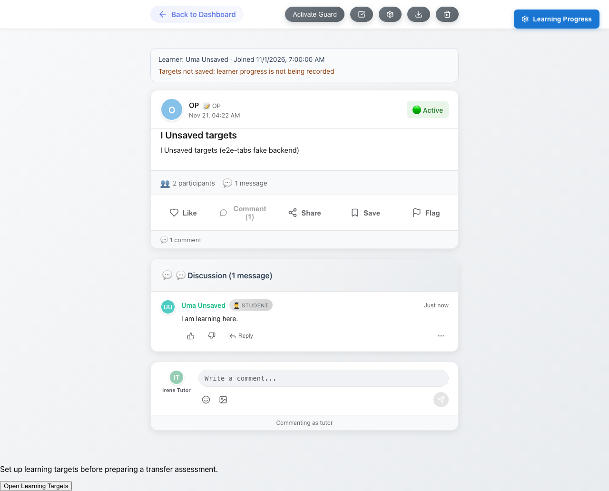

# Client identity cleanup and tutor learner status (#118/#119)

The room owner can see the active learner and whether the server has a checklist for that learner. Dashboard warnings appear when that learner has chatted without saved targets. Local target drafts never establish saved status. Observers and other tutors do not receive the owner summary. Reads use existing tables/policies; no SQL, Edge or server configuration changed.

The request facade uses one injected per-tab identity getter and rejects signed-out calls even with custom transports. The default lazy transport revalidates identity after loading Supabase. StudentView uses the trusted join result and never inserts a session fallback. Observer storage helpers, warning rendering and RoomProvider test probes are shared; operation idempotency is documented in `../client-request-identity.md`.

## Verification and review before PR

- Full Jest: 170 suites passed, 1,711 tests passed, 62 skipped, one snapshot passed. Subsequent test-only lint/import cleanup: 60 tests/7 suites plus 49 tests/6 suites passed; envless import test rechecked separately.
- Production build and dev server: all nine two-tab scenarios A–I passed using real Chromium with the local fake backend. I covers no learner, saved/unsaved targets, learner binding, quiet versus chatting dashboard warnings, join time and observer visibility.
- New regressions cover null learner placeholders; owner switch with pending dashboard fetch; stale owned room on a different route; failed refresh clearing saved state; read pagination; no overlapping refreshes; resubscription reconciliation and committed checklist refresh.
- Independent code, edge and acceptance agents reviewed the diff. Findings fixed: null learner filter, dashboard owner guard, route/observer owner guard and Realtime refresh to match NFR-8. Follow-up reviews report no remaining blockers. Review artifacts identify their reviewed commits; later changes are test import ordering/module declaration and these evidence documents.
- Direct Supabase MCP inspections of both projects confirmed current read policies and actual anon reads. Staging publication includes sessions, checklists and messages. Staging browser smoke used existing records and GET-only REST, blocked writes and Edge calls, and confirmed dashboard and room saved state. It is a limited display/read smoke, not a full live lifecycle or end-to-end Realtime latency measurement. No live fixtures or leases were needed; no server mutations occurred. Local test servers stopped.

## Code-smell assessment

The requested skill ran before PR creation at the CRA package root. Baseline is `244b56f`; common production files and the full changed-file scope were analyzed before/after.

| Signal | Baseline | Candidate | Interpretation |
| --- | --- | --- | --- |
| ESLint on eight common production files | 0 errors, 0 warnings | 0 errors, 0 warnings | No new findings |
| ESLint on changed-file scope | 50 errors, 14 warnings | 50 errors, 13 warnings | All remaining identities pre-existing |
| jscpd across changed-file scope | 176 clones / 2,156 lines | 174 clones / 2,130 lines | Repeated test probe setup reduced |
| Madge | 2 cycles | 2 cycles | Existing cycles remain |
| tsc | 437 diagnostics | 437 diagnostics | Existing test type errors; no new identities after one module declaration fix |
| Gitleaks 8.30.1 | — | 0 findings in changed source | Supplemental redacted scan, not whole-history assurance |

Knip normal/production adds the intentional test-reset export as a production-only candidate; source consumers were checked. Repeated status reads serve initial load, live updates and recovery, with serialization and cancellation tests. Existing dependency audit and depcheck findings remain; no dependency manifests changed. Behavioral analysis is partial because some explicit `.ts` server imports are unresolved. Monitor statuses and raw failures remain visible; this is **not** a completely clean repository scan.

Detailed interpretation lives in the skill's existing `code_smell_report.md` and `summary.json`, alongside raw outputs. Durable private evidence: `/Users/admin/.transfer-assessment-pg17/runs/client-118-119-20261121/` (`smell-baseline-exact`, `smell-final`, earlier failed runs, independent reviews, browser evidence, manifests, logs and supplemental type/secret scans). No credentials or live participant screenshots are committed.

## Release scope

Frontend-only. Before release, required PR CI and independent review must pass. Staging criteria: affected tutor room/dashboard and identity/join journeys, errors and observer status; the local fake journeys plus limited live read smoke are recorded above. Production acceptance after Render serves the merged commit: verify actual frontend version and owner status/identity/join smoke; this remains open until frontend release. No backend promotion or migration is required. Repair owner: Codex for this branch; #118/#119 remain open until merge.

## Screenshot (local fake data)

